# Defect Detection for the injo4.0 Production Line using YOLOv8

**System:** YOLOv8 Defect Detection for Production Line
**Version:** 1.1
**Developer:** Zakaria Aladem

## Introduction to the Defect Detection System

The defect detection system is designed to automate post-production quality inspection using advanced computer vision and IoT technologies. It combines **YOLOv8**, a state-of-the-art deep learning model for object detection, with **MQTT**, a lightweight messaging protocol, to deliver accurate and reliable product classification.

The system only captures and processes images **after a product is fully assembled** and the robot indicates a **ready state**. Each product component such as top, bolt, and bottom is identified and combined to form a unique product code. The detected product is then compared with the expected configuration. Based on this comparison, the system automatically sends a command to **accept** the product if it meets the specifications or **reject** it if a defect is detected.

## Demo

<p align="center">
  <a href="docs/demo.mp4">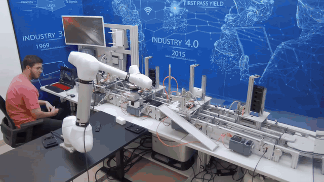</a>
</p>

The robot places the product, the system detects it and compares it with the expected product: a correct **WRW** gets **ACC**, and a product with a missing cylinder gets **REJ**. The original video is in [docs/demo.mp4](docs/demo.mp4).

## Contents

- [1. System Overview](#1-system-overview)
- [2. Repository Structure](#2-repository-structure)
- [3. System Requirements](#3-system-requirements)
- [4. Setup Instructions](#4-setup-instructions)
- [5. Running the System](#5-running-the-system)
- [6. Product and Defect Codes](#6-product-and-defect-codes)
- [7. Display Information](#7-display-information)
- [8. Timing System](#8-timing-system)
- [9. IOT (MQTT)](#9-iot-mqtt)
- [10. Training the YOLOv8 Model](#10-training-the-yolov8-model)
- [11. Troubleshooting](#11-troubleshooting)
- [12. System Maintenance](#12-system-maintenance)
- [13. References](#13-references)

## 1. System Overview

This system uses YOLOv8 (You Only Look Once) for real-time product defect detection. It integrates with an industrial robot via MQTT for automated acceptance (ACC) or rejection (REJ) of products.

**Key Components:**

1. **YOLOv8 Detection:** Detects product components and defects in real-time using a camera.
2. **MQTT Communication:** Sends and receives data between the detection system and robot.
3. **Robot Integration:** Commands the robot to accept or reject products based on detection results.
4. **Display Overlay:** Provides real-time feedback on the video feed, including product type, detection, and robot state.

**Supported Products:** WSB, BRW, WRB, BSW, WRW, WSW, BRB, BSB
**Defects:** DEFECT_NO_CYL, DEFECT_NO_TOP

## 2. Repository Structure

```
├── detector.py              # main program: live detection + robot commands (ACC / REJ)
├── train.py                 # trains the YOLOv8 model
├── config.yaml              # dataset configuration for YOLOv8
├── settings.example.yaml    # template for your settings (copy to settings.yaml)
├── settings.py              # loads settings.yaml
├── requirements.txt
├── weights/
│   └── best22.pt            # trained YOLOv8 weights used by the system
├── dataset/
│   ├── images/              # train/ and test/ images
│   └── labels/              # train/ and test/ annotation .txt files
├── docs/images/             # images used in this README
└── legacy/                  # earlier versions of the detector (liveFeed.py, IOT.py)
```

## 3. System Requirements

**Hardware:**

- Windows 10/11 or Linux machine
- NVIDIA GPU (recommended for real-time detection)
- USB or IP camera
- Production robot with MQTT capability

**Software:**

- Python 3.10+
- YOLOv8 (Ultralytics library)
- OpenCV
- Paho-MQTT

**Installation:**

```bash
pip install -r requirements.txt
```

For GPU detection, install PyTorch with CUDA first (see the notes at the top of `requirements.txt`).

**Files and Folders Needed:**

- `weights/best22.pt` → YOLOv8 trained weights
- `config.yaml` → Dataset configuration for YOLOv8
- `settings.yaml` → your camera, MQTT and timing settings
- Camera access (device index 0 for USB camera)

## 4. Setup Instructions

### 4.1 Camera Setup

1. Connect the camera to your computer.
2. Ensure it is accessible via OpenCV (`cv2.VideoCapture(0)`), `camera` in `settings.yaml`.
3. Test the camera with:

```python
import cv2
cap = cv2.VideoCapture(0)
ret, frame = cap.read()
cv2.imshow("Test", frame)
cv2.waitKey(0)
cap.release()
cv2.destroyAllWindows()
```

### 4.2 MQTT Configuration

All settings are kept in `settings.yaml`, which stays on your computer and is not uploaded to GitHub. Copy the template and fill in your own broker address and topics:

```bash
copy settings.example.yaml settings.yaml     # Windows
cp settings.example.yaml settings.yaml       # Linux
```

**Broker Configuration:**

```yaml
mqtt:
  client_id: "Defect Detector"
  broker: "YOUR_BROKER_ADDRESS"
  port: 1883
```

**Topics Subscribed:**

- `top` → top part of the product
- `bottom` → bottom part of the product
- `bolt` → bolt of the product
- `robot_sequence` → robot state

**Topics Published:**

- `command` → Commands ACC/REJ with optional details.

### 4.3 YOLOv8 Model

1. The trained weights are in `weights/best22.pt` (`model` in `settings.yaml`).
2. Initialize YOLOv8 in the code:

```python
from ultralytics import YOLO
model = YOLO("weights/best22.pt")
```

3. Adjust confidence threshold if needed (`conf: 0.5` in `settings.yaml`).

## 5. Running the System

1. **Start the Script:**

```bash
python detector.py
```

Optional: `python detector.py --camera 1 --device cpu` to change the camera or use the CPU without editing `settings.yaml`.

2. **Fullscreen Display:** The system will display the camera feed in fullscreen. Overlay shows:
   - Robot state (idle/ready)
   - Expected product
   - Detected product
   - Last ACC/REJ command

3. **Detection & Robot Commands:** Wait for the robot to reach READY state. After a short settle delay, the system evaluates the product:
   - Match → send `ACC`
   - Mismatch or defect → send `REJ`
   - Special case: if bolt is null and cylinder is missing → send `ACC`.

4. **Exiting:** Press `q` to safely exit the program.

## 6. Product and Defect Codes

| Code | Product/Defect |
|------|----------------|
| 0 | WSB |
| 1 | BRW |
| 2 | WRB |
| 3 | BSW |
| 4 | WRW |
| 5 | WSW |
| 6 | BRB |
| 7 | BSB |
| 8 | DEFECT_NO_CYL |
| 9 | DEFECT_NO_TOP |

## 7. Display Information

- **Robot State:** Shows current robot readiness.
- **Expected Product:** Displays the product combination robot expects.
- **Detected Product:** Displays YOLOv8 detection result.
- **ACC/REJ Banner:** Shows last command for a few seconds on top of video feed.

## 8. Timing System

The defect detection system uses three key timing parameters `action_delay`, `check_delay`, and `display_duration` to synchronize image capture, detection, and communication with the robot. These parameters ensure that every product is analyzed at the correct time, preventing redundant actions and maintaining smooth operation within the production line. They can be adjusted in `settings.yaml`.

```yaml
timing:
  action_delay: 5      # Minimum time between two robot actions (seconds)
  check_delay: 2       # Wait time after robot ready signal before detection (seconds)
  display_duration: 3  # Duration to display ACC/REJ banner on screen (seconds)
```

### 1. `action_delay`

**Definition:** `action_delay` defines the minimum time interval between two consecutive system actions or MQTT commands. It ensures that the robot is not flooded with repeated "ACC" or "REJ" messages, which could lead to undesired or conflicting mechanical responses.

**Default Value:** 5 seconds

**Function:** Before the system sends a new command, it checks whether the time elapsed since the last action exceeds the `action_delay` threshold.

**Recommended Adjustment:**

- Increase if the robot needs more time to complete actions.
- Decrease only if the robot can handle faster operations safely.

### 2. `check_delay`

**Definition:** `check_delay` specifies the time the system should wait after the robot signals that a product is **ready for inspection**. This allows the product to stabilize before the image is captured, ensuring sharp and accurate detections.

**Default Value:** 2 seconds

**Function:** When the robot sends a "ready" signal, the system starts a timer. Only after `check_delay` seconds does the camera capture and process an image.

**Code Example:**

```python
if check_start_time is None:
    check_start_time = now
    print("⏳ Robot ready — starting settle timer...")

elif now - check_start_time >= check_delay and now - last_action_time >= action_delay:
    print("🔎 Checking product after settle delay...")
```

**Recommended Adjustment:**

- Increase if camera shake or motion blur occurs.
- Decrease if products are already stable faster.

### 3. `display_duration`

**Definition:** `display_duration` determines how long the inspection result (either "ACC" or "REJ") remains visible on the operator display.

**Default Value:** 3 seconds

**Function:** The system overlays a colored banner on the display window showing the decision result. This banner automatically disappears after the specified time.

**Code Example:**

```python
if last_command and (time.time() - last_command_time) <= display_duration:
    banner_text = f"{last_command}  {last_command_detail}"
    ...
```

**Recommended Adjustment:**

- Increase for slower-paced operations or when operator confirmation is important.
- Decrease for fast-paced lines.

## 9. IOT (MQTT)

Now that our model is fully trained we need to connect it to the IoT system that the production system is on. To do that we use the paho library.

### MQTT Library Overview

**MQTT** (Message Queuing Telemetry Transport) is a lightweight publish/subscribe messaging protocol commonly used for IoT, robotics, and industrial automation. It allows devices to communicate asynchronously in real-time.

**Popular Python library:** `paho-mqtt`

**Installation:**

```bash
pip install paho-mqtt
```

### Core Concepts

**1. Broker**

- The central server that manages messages.
- Clients connect to the broker to send (publish) or receive (subscribe) messages.
- Examples: Mosquitto, HiveMQ, EMQX.

**2. Client**

- Any device or program that connects to the broker.
- In your system: the YOLOv8 detection script acts as a client.

**3. Topic**

- A string that identifies a "channel" for messages.
- Example: `"production/inspection/results"`

**4. Publish / Subscribe**

- **Publish:** Send data to a topic.
- **Subscribe:** Receive data from a topic.

### 1. MQTT Setup

You are using `paho-mqtt`, a lightweight Python library for MQTT communication. Key steps:

```python
client = mqtt.Client(
    client_id=clientid,
    protocol=mqtt.MQTTv311,
    transport="tcp",
    callback_api_version=CallbackAPIVersion.VERSION2
)
```

- `client_id="Defect Detector"`: a unique identifier for this MQTT client.
- `protocol=mqtt.MQTTv311`: using MQTT version 3.1.1.
- `transport="tcp"`: standard TCP connection.
- `callback_api_version=VERSION2`: ensures callbacks match the latest API format.

Then you assign callback functions for connection, subscription, and incoming messages:

```python
client.on_connect = on_connect
client.on_subscribe = on_subscribe
client.on_message = on_message
```

Finally, the client connects to the broker and starts its loop:

```python
client.connect(broker, port)
client.loop_start()
```

`loop_start()` runs the network loop in a separate thread, so your program can continue while receiving messages asynchronously.

### 2. MQTT Callbacks

**on_connect**

```python
def on_connect(client, userdata, flags, reason_code, properties=None):
    client.subscribe(TOPICS["top"])
    client.subscribe(TOPICS["bottom"])
    client.subscribe(TOPICS["bolt"])
    client.subscribe(TOPICS["robot_sequence"])
```

- Triggered when the client successfully connects to the broker.
- Subscribes to **topics** that provide the robot's state and product component feedback.

**on_message**

```python
def on_message(client, userdata, msg):
    global top, bolt, bottom, currentProduct, robotState
    ...
```

Triggered whenever a message is received on a subscribed topic. Converts payload to integer, identifies the topic, and updates **runtime state variables**:

- `top`, `bolt`, `bottom` → components of the current product.
- `currentProduct` → combined code like `"WSB"` or `"BRW"`.
- `robotState` → tracks if the robot is ready.

This ensures your detection system **knows when the robot is ready** and **what product configuration to expect**.

### 3. Publishing Messages

```python
def publish_message(client, topic, message, detail=""):
    result = client.publish(topic, message)
    status = result[0]
    ...
```

Sends commands back to the broker (e.g., `"ACC"` or `"REJ"`). Updates `last_command` variables to track timing and avoid sending duplicate commands.

### 4. Integration with YOLOv8

1. YOLOv8 detects a product or defect.
2. The system compares it to `currentProduct`.
3. If matched → `publish_message(client, TOPICS["command"], "ACC")`
   If defect → `publish_message(client, TOPICS["command"], "REJ")`

This allows **real-time inspection results to be communicated to the robot/SCADA system**.

## 10. Training the YOLOv8 Model

### Introduction to Computer Vision

Computer vision is a field of machine learning that focuses on enabling machines to interpret and understand visual information from the world. It uses pattern recognition techniques to detect objects within an image or to segment images into meaningful parts.

Computer vision has a wide range of applications across many industries, including disease detection, robotics, automation, and more.

The main workhorse behind modern computer vision is the **neural network**, and more specifically, the **convolutional neural network (CNN)**. We will not go into the detailed mathematics and concepts of CNNs in this document. Instead, our focus will be on creating simple models with as few commands as possible. This approach reduces troubleshooting challenges and makes it easier for you to replicate and improve upon the model presented here.

For a deeper explanation of the concepts that make up a computer vision model, references are provided at the end of this document.

<p align="center">
  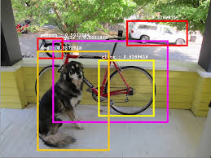
  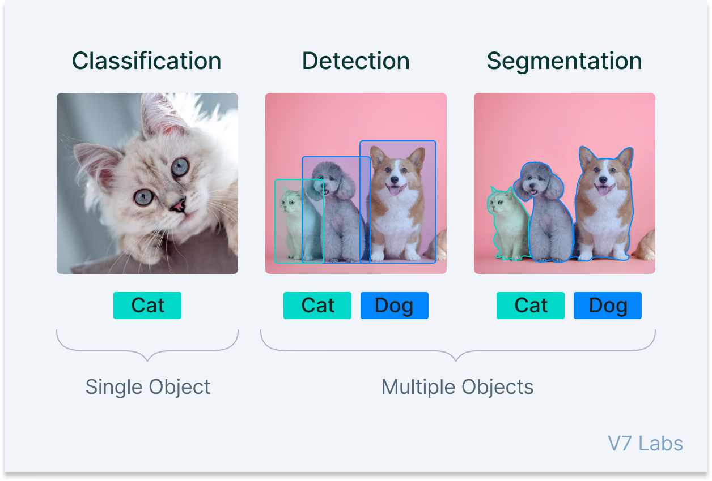
</p>

### Useful Terminology

> **Note:** It is highly recommended to learn about NN (Neural Networks) and CNN (Convolutional Neural Networks) for easier model manipulation and to understand the inner workings of these systems.

**Training Set**
The training set is the portion of the dataset used to **teach the model**. The model learns patterns, features, and relationships from these examples.

- Typically **70–80%** of the total dataset.

**Testing Set**
The testing set is the portion of the dataset used to **evaluate the model** after training. It helps measure how well the model generalizes to **unseen data**.

- Typically **20–30%** of the total dataset.

**Batch Size**
A batch is a subset of the dataset that is fed into the neural network at one time during training. Using batches helps the model learn efficiently without overloading memory (RAM).

**Example:** Say we had 1000 images in our dataset and the batch size is 100. Then 100 images will go through the network at a time.

**Epoch**
An epoch is one complete pass through the entire training dataset. Multiple epochs are usually needed for the model to learn patterns effectively. Usually (10–100), ideally 50.

**Iteration**
An iteration refers to a single update of the model's weights using one batch. For example, if your dataset has 1000 images and your batch size is 100, it takes 10 iterations to complete one epoch.

**Loss**
Loss is a measure of how well the model's predictions match the actual labels. Lower loss indicates better performance.

**Accuracy**
Accuracy measures the percentage of correct predictions made by the model. It's a common metric to evaluate classification tasks.

**Segmentation**
Segmentation is the process of dividing an image into meaningful regions or segments. For example, separating objects from the background or distinguishing parts of an object.

**Overfitting**
Overfitting occurs when a machine learning model learns the training data too well, including its **noise and random fluctuations**, instead of generalizing to new, unseen data. In other words, the model performs very well on the training set but poorly on the testing or validation set.

**API (TensorFlow, PyTorch)**
APIs like TensorFlow and PyTorch provide tools and pre-built functions to create, train, and evaluate neural networks efficiently. They are widely used in computer vision and machine learning projects.

### YOLO (You Only Look Once)

- **Definition:** YOLO is a state-of-the-art, real-time object detection algorithm introduced in 2015.
- **Key Idea:** Treats object detection as a **regression problem**, predicting bounding boxes and class probabilities in a single pass through a CNN.

#### YOLO Evolution

| Version | Key Improvements |
|---------|------------------|
| YOLOv1 (2015) | Fast, unified detection; struggles with small objects. |
| YOLOv2 (2016) | Darknet-19 backbone, batch normalization, anchor boxes, higher input resolution. |
| YOLOv3 | Darknet-53 backbone, multi-scale predictions, logistic classifiers. |
| YOLOv4 | CSPDarknet53, SPP block, PANet, mosaic data augmentation, optimized for production. |
| YOLOv5 | PyTorch implementation, Focus layer, multiple model sizes (s, m, l, x). |
| YOLOv6 | Industrial applications, decoupled head, hardware-friendly design. |
| YOLOv7 | E-ELAN architecture, trainable bag-of-freebies for improved accuracy. |
| YOLOv8 | Modular design, segmentation & pose estimation, lightweight models, better APIs. |
| YOLO-NAS | Neural Architecture Search for optimized structure and performance. |
| YOLOv9 (2024) | PGI and GELAN for improved training and feature aggregation, state-of-the-art accuracy & efficiency. |

### YOLOv8 Overview

**Release Date:** January 10, 2023, by Ultralytics.

**Purpose:** YOLOv8 is a **state-of-the-art computer vision model** designed for real-time object detection, instance segmentation, pose/keypoints detection, oriented object detection, and image classification. Essentially, it can "see" objects in images or videos, figure out their boundaries, understand their orientation, and even recognize human poses.

#### Key Improvements in YOLOv8

1. **Advanced Backbone and Neck Architectures**
   - The **backbone** is the part of the network responsible for extracting features (edges, textures, shapes) from the input image.
   - The **neck** combines and refines these features before detection.
   - YOLOv8 uses modern architectures that **improve feature extraction**, making the model better at detecting objects, even small or overlapping ones.
2. **Anchor-free Split Ultralytics Head**
   - Previous YOLO versions used **anchor boxes**—predefined boxes of various shapes and sizes—to predict object locations.
   - YOLOv8 is **anchor-free**, meaning it predicts object locations directly without relying on fixed anchor boxes.
   - The **split head** separates classification (what the object is) and localization (where the object is), improving both **accuracy** and **speed**.
3. **Optimized Accuracy-Speed Tradeoff**
   - YOLOv8 is designed to be **fast enough for real-time applications** while maintaining high accuracy.
   - This makes it suitable for devices with limited computing power (like drones, robots, or cameras) as well as high-end GPUs.
4. **Variety of Pre-trained Models**
   - YOLOv8 comes in **five sizes**: `n` (nano), `s` (small), `m` (medium), `l` (large), and `x` (extra-large).
   - Smaller models are **faster but less accurate**, while larger models are **slower but more precise**.
   - This gives flexibility depending on your application's speed and accuracy needs.

#### YOLOv8 Model Variants

YOLOv8 supports multiple tasks beyond just object detection. Here's a breakdown:

| Variant | Task | What it does |
|---------|------|--------------|
| YOLOv8 | Object Detection | Detects objects and draws bounding boxes. |
| YOLOv8-seg | Instance Segmentation | Detects objects **and outlines their exact shape**. |
| YOLOv8-pose | Pose/Keypoints | Detects human keypoints, like joints, for pose estimation. |
| YOLOv8-obb | Oriented Object Detection | Detects objects with **rotated bounding boxes** for aerial or industrial images. |
| YOLOv8-cls | Classification | Classifies the whole image into categories (no bounding boxes). |

> Each variant can be used for **training**, **validation**, **inference**, and **export**, making them easy to integrate into production systems.

#### Performance Metrics (COCO Dataset)

COCO is a standard dataset for object detection. Here's what the table means:

| Model | mAP 50-95 | CPU (ms) | GPU (ms) | Params (M) | FLOPs (B) | Explanation |
|-------|-----------|----------|----------|------------|-----------|-------------|
| YOLOv8n | 37.3 | 80.4 | 0.99 | 3.2 | 8.7 | Fastest, lightweight, good for low-power devices. |
| YOLOv8s | 44.9 | 128.4 | 1.20 | 11.2 | 28.6 | Small model, balance of speed and accuracy. |
| YOLOv8m | 50.2 | 234.7 | 1.83 | 25.9 | 78.9 | Medium model, better accuracy. |
| YOLOv8l | 52.9 | 375.2 | 2.39 | 43.7 | 165.2 | Large model, high accuracy, slower inference. |
| YOLOv8x | 53.9 | 479.1 | 3.53 | 68.2 | 257.8 | Largest and most accurate, best for offline or high-power GPUs. |

**Key terms:**

- **mAP 50-95:** Mean Average Precision, measures detection accuracy. Higher is better.
- **CPU/GPU (ms):** Inference speed, lower is faster.
- **Params:** Number of learnable parameters; more params = larger model, potentially more accurate but slower.
- **FLOPs:** Floating Point Operations, computational cost of the model.

### Getting a Dataset

To start, we need data for training. The dataset can be a ready-made one or your own creation.
🔗 [Open Images Dataset](https://storage.googleapis.com/openimages/web/index.html)

#### Factors Affecting Dataset Size

The size of a dataset needed for training a computer vision model depends on several factors:

1. **Number of Classes (Objects) to be Detected**
   - More classes require more examples per class to ensure the model can learn to distinguish between them.
   - Example: Detecting 2 types of objects may need hundreds of images, while detecting 20 types may require thousands.
2. **Required Accuracy**
   - Higher accuracy demands a larger dataset.
   - More examples help the model generalize better and reduce overfitting.
3. **Similarity Between Classes**
   - If classes look very similar, the model needs more data to learn subtle differences.
   - Example: Different types of apples may require more images than detecting apples vs. cars.

### Annotation

The next step is to annotate the dataset. Annotation (or labeling) tells the model what it is looking at in the images by drawing bounding boxes around objects and assigning labels. This helps the model recognize these objects during training and testing.

**Recommended Tool:** [CVAT](https://www.cvat.ai/)

- If you are using a pre-made dataset, check if it already contains annotations.
- If it does, simply convert the annotations into the **YOLO1.1 format**, which is the format required by the YOLO algorithm.

**Steps in CVAT:**

1. Create a new project and add all the labels you need.

   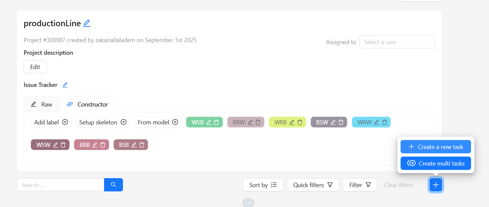

2. Create a task.
3. Add all the images to the task.

   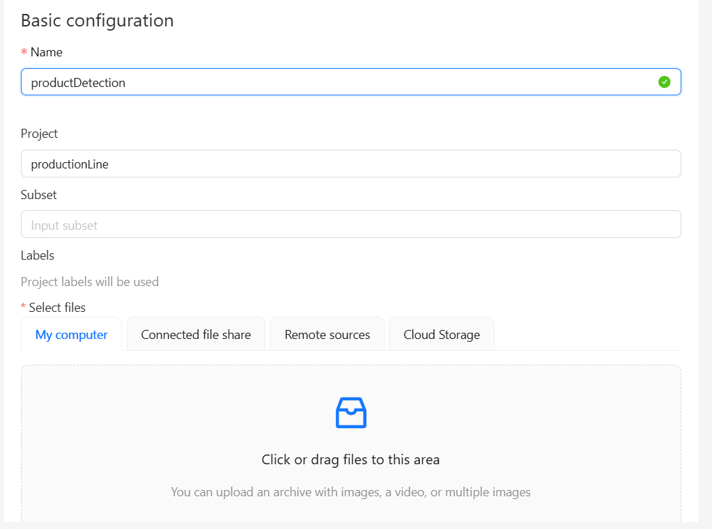

4. Click on the job number to start annotating.

   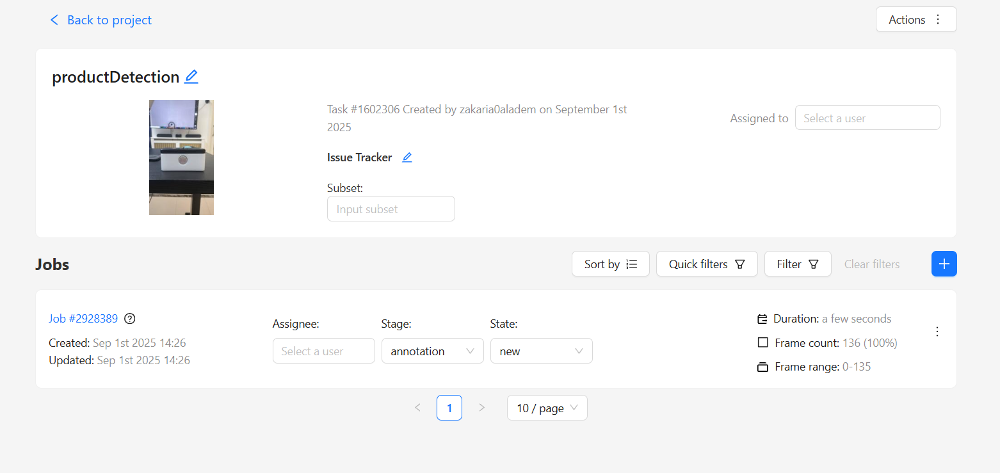

5. Label all images by drawing bounding boxes.

   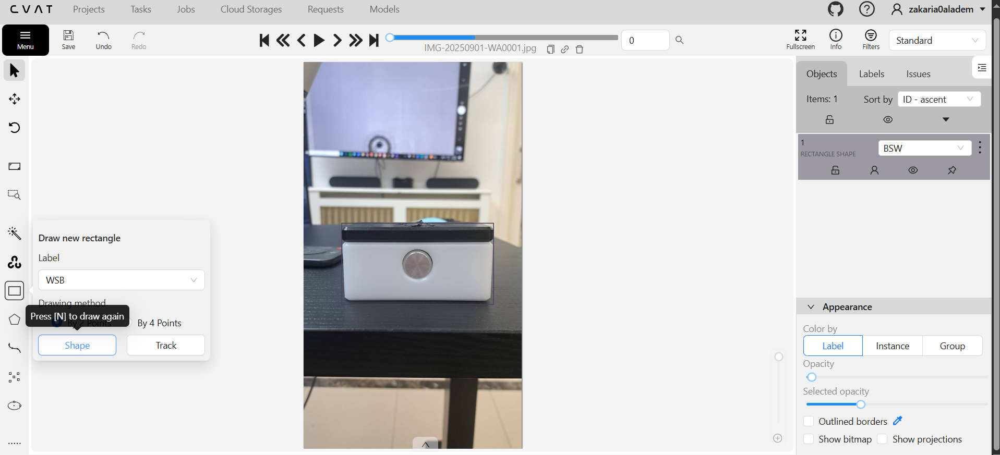

### Image Formatting

Each algorithm requires a specific annotation format. For **YOLOv8**, the required format is **YOLO1.1**.

To export annotations in YOLO1.1 format from CVAT:

- Go to tasks → options (three dots) → export dataset → choose **YOLO1.1**.

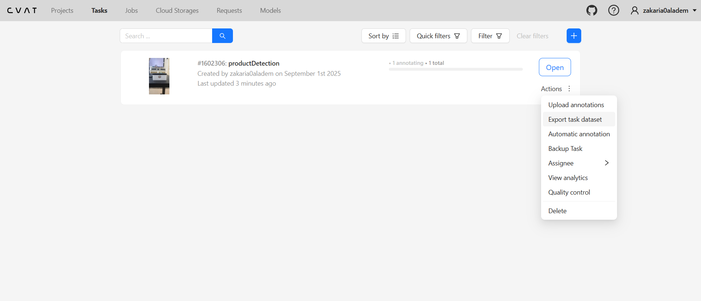

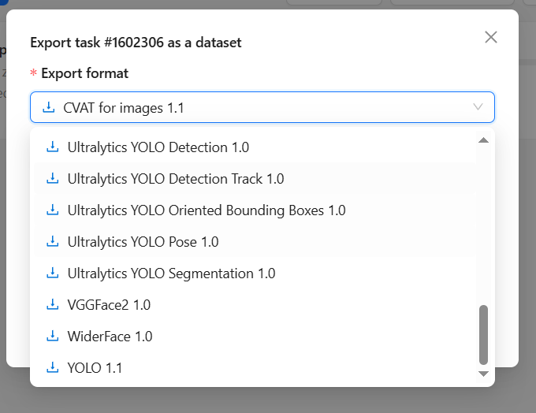

#### What is the "YOLO1.1" Format?

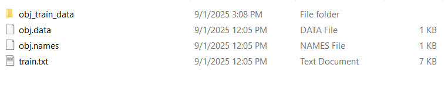

After exporting the dataset, inside the `train` folder, you will find text files corresponding to your images. Each file contains:

1. **Class ID** → e.g., 0–7 if you have 8 classes.
2. **Center coordinates** of the bounding box (relative to the image).
3. **Width and height** of the bounding box.

```
6 0.397253 0.667343 0.036932 0.057241
5 0.173297 0.935014 0.053031 0.097639
```

### Folder Creation

After extracting the YOLO1.1 dataset, create two main directories:

- `images/` → contains all original images.
- `labels/` → contains annotation `.txt` files.

Both folders should have files with matching names (but different extensions).

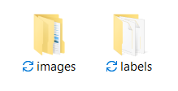

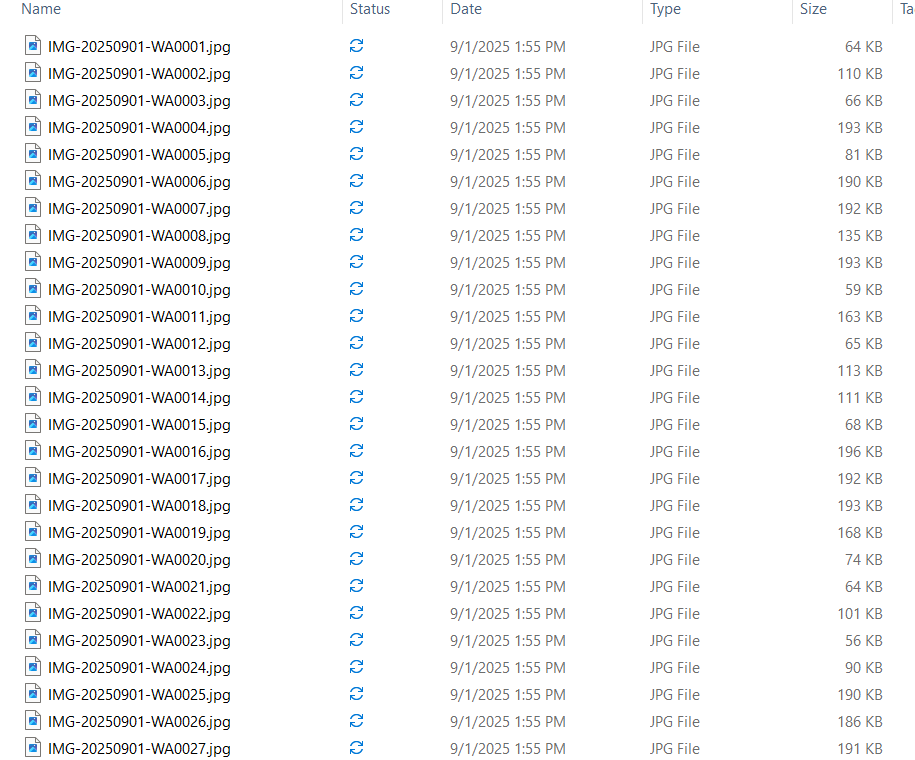 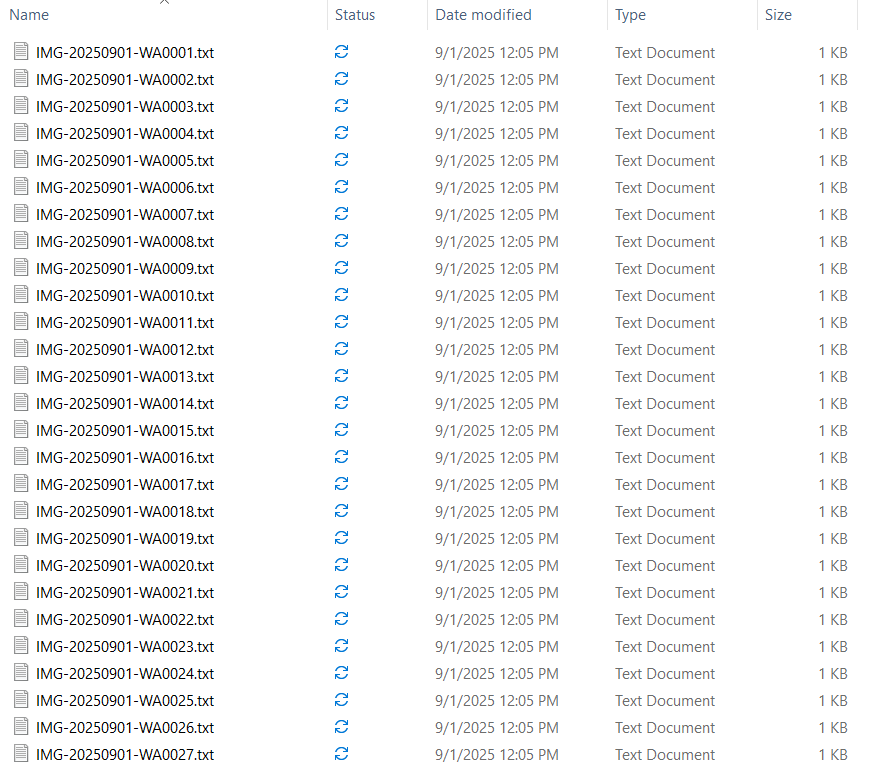

In this repository they are in `dataset/images/{train,test}` and `dataset/labels/{train,test}`.

### Training

Now that the dataset is ready, we can train the model.

1. Install the `ultralytics` library (which includes YOLOv8).
2. Initialize and configure the model (`train.py`):

```python
from ultralytics import YOLO

def main():
    model = YOLO("yolov8s.yaml")
    result = model.train(
    # yaml is a configuration file
        data="config.yaml",
        epochs=300,
    # Data Augmentation
        hsv_v=1,
        degrees=10,
        translate=0.1,
        scale=0.2,
        shear=2.0,
    # GPU, but additional steps are required
    # If you want to use the CPU then replace 'cuda' with 'cpu'
        device='cuda'
    )

if __name__ == "__main__":
    import multiprocessing
    multiprocessing.freeze_support()  # needed for Windows
    main()
```

3. Configure the model (`config.yaml`)
   Used to define settings, parameters, and paths for a project—in this case, for training a YOLOv8 model. The YAML file typically specifies **dataset paths** (where training and validation images and labels are stored), **class names** and their corresponding IDs, and sometimes additional settings.

```yaml
#dir path
path: dataset
# folders inside dir
train: images/train
val: images/test
#class names
names:
  0: WSB
  1: BRW
  2: WRB
  3: BSW
  4: WRW
  5: WSW
  6: BRB
  7: BSB
  8: defective_no_cylinder
  9: defective_no_top
```

4. Train the model:

```bash
python train.py
```

### Training Rules

Training a computer vision model is more of an **art** than an exact science. The same model can be trained in different ways to yield similar results. However, here are some best practices:

**1. Batch size → Adjust according to your device's RAM.**

- **Small GPU/RAM:** Use smaller batches (4–16).
- **Large GPU/RAM:** Use bigger batches (32–64) to stabilize training.

**2. Experiment with epochs for better convergence.**
The smaller the dataset the more epochs needed to reach an acceptable accuracy.

- Small datasets → More epochs needed (200–500).
- Large datasets → Fewer epochs (50–100) may suffice.

**3. Learning Rate**
**Definition:** How much the model updates weights after each batch.

- Too high → Model may diverge.
- Too low → Training is slow.

**Idea:** Start with 0.01 or 0.001 and reduce LR if loss stops decreasing.

**4. Data Augmentation**
Data augmentation is a technique used to artificially expand the size and diversity of a dataset by applying transformations such as flipping, rotation, scaling, translation, color adjustments, or more advanced methods like mosaic and MixUp. Instead of collecting more real-world images, which can be costly or time-consuming, augmentation modifies existing images to create new training examples. This process helps the model generalize better by exposing it to objects under different angles, lighting, and scales, reduces overfitting by preventing the model from memorizing the training data, improves robustness to real-world variations, and can simulate rare conditions that might not appear frequently in the original dataset.

**Common Techniques:**

- Flip: Horizontally/vertically flip images.
- Rotation: Rotate by 15–30°.
- Scaling & Cropping: Random zoom or crop.
- Color Jitter: Change brightness, contrast, saturation.

> **Note:** An example of Data Augmentation is in the training section. See also: https://docs.ultralytics.com/guides/yolo-data-augmentation/

### Model Performance Evaluation

After training your YOLOv8 model, the evaluation results are stored in the training folder:

**Folder:** `runs\detect\train`

**Key files to review:**

1. **`results.png`**
   Visual summary of training and validation metrics over epochs (e.g., loss curves, mAP). Helps quickly assess if the model converged and how well it performed.
2. **`best.pt`** (located in `runs\detect\train\weights`)
   The weights file of the model that achieved the best performance on the validation set. Use this file for inference and deployment.
3. **`val_batch_pred.jpg`**
   Example image(s) showing the model's predictions on the validation set. Useful for a qualitative check to see how well the model detects objects in real-world scenarios.

> **Tip:** Always evaluate both **quantitative metrics** (loss, mAP, precision, recall) and **qualitative predictions** (`val_batch_pred.jpg`) to confirm that the model performs robustly under different conditions.

Here's a clear explanation of those common **YOLOv8 (and general object detection) metrics**:

**1. Loss**
A measure of how well the model's predictions match the ground truth during training. YOLOv8 typically combines three components:

1. **Box loss** how accurate the predicted bounding boxes are.
2. **Objectness loss** how confident the model is that an object exists in a box.
3. **Classification loss** how accurate the predicted class is.

**Lower loss = better model fit.**

**2. mAP (mean Average Precision)**
A standard metric in object detection to evaluate overall model performance.

- **AP (Average Precision)** measures how well the model detects one class.
- **mAP** averages AP across all classes.
- Usually reported at different IoU (Intersection over Union) thresholds like mAP@0.5.

**Higher mAP = better detection accuracy.**

**3. Precision**
Measures how many of the detected objects are actually correct.

$$\text{Precision} = \frac{TP}{TP + FP}$$

**High precision** means few false positives.

**4. Recall**
Measures how many of the actual objects were correctly detected.

$$\text{Recall} = \frac{TP}{TP + FN}$$

**High recall** means few missed detections.

## 11. Troubleshooting

| Issue | Possible Cause | Solution |
|-------|----------------|----------|
| Camera not detected | Wrong device index | Change `camera` in `settings.yaml` to the correct index |
| MQTT connection fails | Wrong broker IP/port | Check broker address, port, and network |
| No detection | Camera not aligned, low lighting | Adjust camera angle/lighting |
| Wrong ACC/REJ sent | Model misclassified | Retrain model with more images or adjust confidence |
| Script freezes | GPU/CPU overload | Reduce frame size or use smaller YOLO model (e.g., YOLOv8n) |

## 12. System Maintenance

- Regularly update YOLOv8 and `paho-mqtt`.
- Monitor `results.png` to detect training drift if retraining.
- Calibrate camera periodically for optimal detection.
- Ensure robot communication remains active; check broker logs.

## 13. References

1. [Ultralytics YOLOv8 Documentation](https://docs.ultralytics.com/)
2. [Open Images Dataset](https://storage.googleapis.com/openimages/web/index.html)
3. [CVAT Annotation Tool](https://www.cvat.ai/)
4. [MQTT Protocol Overview](https://mqtt.org/)
5. [Python MQTT library](https://pypi.org/project/paho-mqtt/)
